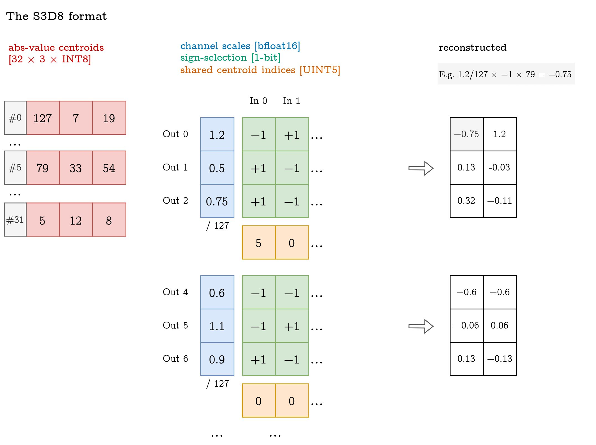
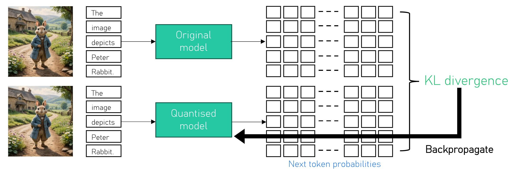

# 11 billion parameters on a phone

<p class="post-subtitle">Achieving 2.7 bits/parameter using our S3D8 format and QAT recipe</p>

_"Let's put Llama-3.2-11B-Vision-Instruct on a phone."_

That meant fitting an 11B-parameter vision-language model into a 4 GB budget: under 3 bits/parameter, with minimal format-decoding overhead and without access to the original training data for our fine-tuning.

So we developed a new quantised weight format called S3D8, designed specifically for Arm phone CPUs, and a QAT recipe that samples prompts, uses the teacher to generate responses, then fine-tunes the quantised weights with a distillation loss. The result is a 3.7 GB model that runs on an Android phone 😅.

This post is an interactive walkthrough of the format, training recipe and results that support our paper, [Llama-Mobile: Efficient 2.7-bit Quantization of VLMs](https://arxiv.org/abs/2608.21134), coauthored with Jeevan Bhoot at Arm. We hope it's a fun ride!

<!-- more -->

_Here's a taste - an installable (if you're brave) Android demo of our quantised model running on my phone._

<video controls autoplay muted loop playsinline preload="metadata" style="border-bottom: 0.5px solid #444; width: 250px;">
  <source src="/2026/08-llama-mobile/img/demo.mp4" type="video/mp4">
</video>

<details markdown>
<summary markdown>Trying the demo</summary>

We release the demo shown above for Android as a proof-of-concept. It requires large model file downloads, is slow (prefill on GPU/NPU could help here) and a memory hog, so it's mainly a way to fact-check us, not a practical local VLM 😅!

_(We wanted a challenge - to fit a model that was "too large" for a phone - but in practice you probably don't want to run the largest model that fits on your device!)_

<!-- You can install the Android demo using this link: -->

[:material-download: Download demo.apk](https://graphcore-research-public.s3.eu-west-1.amazonaws.com/2026-llama-mobile/demo.apk){ .md-button }

System requirements:

 - 8 GB RAM
 - 4-5.5 GB of free storage
 - Arm CPU support for `i8mm` and `bf16`, e.g. Pixel 8a (2024) or newer

This is a sideloaded APK, so Android will likely ask you to enable installation from untrusted sources for your browser or file manager.

Advanced mode: check the code and build it yourself from the [code on GitHub](https://github.com/graphcore-research/llama-mobile-vlm/tree/main/android){ target="blank" }.
</details>

## S3D8: a 2.7-bit weight format for _fast decoding_ 🏎

To achieve our goal of running the model on a phone, we need to fit 11B parameters in roughly 4 GB, i.e. less than 3 bits/parameter. To be practical, we must achieve this size while retaining as much downstream task performance as possible and also supporting efficient format decoding and computation.

First, we must design a format that can approximate weights at low precision, while being efficient to decode on the Arm CPU. This is a _storage format_, which is only used for storing the weights, and need not be directly supported by the hardware. This is distinct from the _compute format_, which is used by both weights and activations when doing the actual maths.

**S3D8** is a storage format that decodes 3 weights per 8 bits to channel-scaled INT8 (the compute format). It stores:

 - <strong class="s3d8-highlight s3d8-abs-centroids">absolute-value centroids</strong>: a 32 × 3 table of positive INT8 values (per matrix)
 - <strong class="s3d8-highlight s3d8-channel-scales">channel scales</strong>: a bfloat16 scale (per output channel)
 - <strong class="s3d8-highlight s3d8-centroid-indices">shared centroid indices</strong>: a 5-bit index (per 3 weights)
 - <strong class="s3d8-highlight s3d8-sign-bits">sign-selection information</strong>: 3 bits (per 3 weights), representing one sign selector per weight

To reconstruct a weight, we use the <span class="s3d8-highlight s3d8-centroid-indices">shared centroid index</span> to look up a row in the <span class="s3d8-highlight s3d8-abs-centroids">absolute-value centroid table</span>. This gives us a 3-vector of weights for consecutive output channels, from which we select the appropriate component. We then use the corresponding <span class="s3d8-highlight s3d8-sign-bits">sign selector</span> to choose its positive or negative form, and multiply by the <span class="s3d8-highlight s3d8-channel-scales">channel scale</span>. This is illustrated below:

{style="width: 700px;"}

### Understanding S3D8

S3D8 is designed around the constraint of fast format decoding on Arm CPUs, while trying to minimise reconstruction error of weights. The key design decision is to use a short vector format with symmetry (i.e. storing sign-selection information separately).

_Hardware support:_ Lookup tables are often used to decode low-bit storage formats into compute formats, as an alternative to multiple bit-shift, masking and arithmetic instructions. The Arm [`tbl` instruction](https://developer.arm.com/documentation/100069/0606/SIMD-Vector-Instructions/TBL--vector-){target="blank"} is an example of an in-register lookup table, supporting a maximum of 6-bit indices into a 64-entry lookup table, and returning a single byte. Compared with in-memory lookup tables, in-register tables are heavily size-constrained, but support many more parallel lookups per cycle (e.g. 16 lookups/instruction × 2/3 instruction/cycle for `tbl` with 6-bit indices on a [Cortex-X3](https://developer.arm.com/documentation/pjdoc466751330-590747/0102/){target="blank"}).

_Reconstruction fidelity:_ Even if we assume weights are independently distributed, the best formats for a given size will use either/both of: variable-length coding and representing vectors of values (rather than independent scalars). Such formats can approach the Shannon bound more closely by fitting to the shape of the data distribution.

When using aggressive quantisation, short vector formats offer a promising intersection of hardware support and reconstruction fidelity requirements. We can reshape the weights into short vectors, train a lookup table to minimise reconstruction error using k-means, and use fast in-register table lookups for format decoding. For S3D8, we also exploit symmetry in the distribution of weights that have been reshaped into such short vectors to reduce the size of the lookup table. We pack 3 weights in 8 bits using a 5-bit index to select a centroid containing their 3 absolute values, then reserve 3 bits for per-weight sign selection.

We can compare centroids trained in this way (S3D8) to an unstructured format of 256 centroids for signed values (3D8) and a scalar format with 6 centroids (1D(8/3)). Note that S3D8 and 3D8 have 256 centroids (after multiplying out the signs), while 1D(8/3) has $6^3$ = 216 centroids, so is slightly disadvantaged by being more compact. Have a play:

<div id="s3d8-centroid-cloud">
Interactive centroid plot requires JavaScript.
</div>
<script defer src="/2026/08-llama-mobile/js/s3d8-centroid-cloud.js"></script>

That's probably enough for now! But if you _really_ want to delve deeper into every step of our reasoning, we discuss the design choices in more detail below.

<details markdown>
<summary markdown>S3D8 design notes</summary>

#### Why 2.7 bits/parameter?

An interesting post-training compression regime is roughly 2-4 bits/parameter. Above this, task performance is easier to preserve, but the model is larger than it needs to be. Below this, quantisation error starts to dominate and the model needs extensive retraining to recover reasonable task performance. Since S3D8 uses short vector quantisation, it can offer a better rate/distortion tradeoff than scalar quantisation. We therefore choose a somewhat aggressive 2.7 bits/parameter, giving QAT an opportunity to recover task performance.

#### Compute format: INT8

INT8 has compute support in the Arm dotprod and i8mm extensions, which are broadly supported in modern mobile CPUs. As the fastest widely available compute format at time of writing, it provides substantially higher arithmetic throughput than bfloat16 or float16. S3D8 is therefore a storage format. At runtime, we decode S3D8 weights to channel-scaled INT8 and use the CPU's existing INT8 matrix-multiply support.

#### Vector quantisation

The Arm SIMD instruction set includes `tbl`, which selects bytes from an in-register lookup table of 16, 32, 48 or 64 entries. For scalar lookup-table quantisation, a common optimisation is to form larger vector lookup tables, rather than separately masking and shifting small indices. These vector lookup tables are the Cartesian product of the scalar centroids, so replacing them with trained vector centroids has no additional lookup cost in the decoder.

#### Absolute-value centroids and sign selection

The most straightforward 3-values-per-byte vector format would use a single 8-bit centroid index into a `(256, 3)` lookup table. That table would contain 768 bytes, which is too large for SIMD registers (which are also needed for intermediate values, especially in fused dequantise-dot-product kernels). We expect the main benefit of vector quantisation to come from matching the distribution shape, rather than from learning arbitrary sign covariance structures. S3D8 therefore specifies the 256 signed centroids as the 8 reflections of 32 absolute-value centroids. This allows for a `(32, 3)` absolute-value centroid table, with separate sign selectors.

#### Fusing sign selection into lookups

A straightforward implementation would look up the absolute value of each vector element, then unpack its sign selector and apply the selected sign. We are not aware of a fast way to do this in Arm Advanced SIMD: simple approaches require several shift, mask and two's-complement operations for each of the 3 elements. S3D8 trades register pressure for instruction count by constructing lookup tables that already contain signed values. This requires 3 × 64-byte lookup tables, but lets the sign selector form one bit of the lookup index.

#### Bit layout

Let `S0`, `S1` and `S2` be the sign selectors for the 3 weights, where 0 selects the positive value and 1 the negative value. A natural packing would be `[S2, S1, S0, Q4..0]`, with the lower 5 bits encoding the centroid index `Q` and the upper 3 bits encoding the sign selectors. However, this requires additional bit manipulation to construct the indices into signed-value lookup tables.

S3D8 instead uses the physical byte layout `[S2 EOR S0, S1, Q4..0, S0]`. It stores `S0` in bit 0, `S1` in bit 6 and the sign-difference bit `S2 EOR S0` in bit 7. These fields control lookup selection; none is a two's-complement sign position. The 3 unsigned indices into the signed-value lookup tables can then be constructed cheaply:

 - `I0 = [Q4..0, S0]`, with the sign selector in the LSB, is computed with a single `AND` mask
 - `I1 = [S1, Q4..0]`, with the sign selector in the MSB, is computed with a shift and `AND`
 - `I2 = [Q4..0, S2]`, with the recovered sign selector in the LSB, is computed with a shift and `EOR` with `I0`

This relies on permuted lookup tables: the tables for `I0` and `I2` are stored in sign-minor order, with the sign selector in the index LSB, while the table for `I1` is stored in sign-major order, with the selector in the index MSB. All operations are vectorised over 16 byte lanes. Since the model bit-packing and lookup-table permutation are performed once before loading the model, there is no runtime cost to choosing this layout.

#### Output channel packing

It might seem natural to pack elements consecutive on the reduction axis into a single byte. However, this would require extra instructions to interleave decoded weights, or to unzip them from the input vector. Since fast kernels typically compute multiple outputs in a single pass through the inputs for sake of reusing inputs and exploiting instruction-level parallelism, S3D8 packs elements from consecutive _output_ channels into each byte.

</details>

### Format decoding on Arm CPUs

We combine the S3D8 format described above with an efficient bit-packing scheme which permits high-throughput format decoding on Arm CPUs. This scheme, illustrated below, expands each column of the 32 × 3 absolute-value lookup table across both sign selections, producing 3 separate 64 × 1 signed-value lookup tables. There is therefore no need to apply the selected sign separately.

The lowest 6 bits, `5-0` (shared index and first sign selector), are used as the first index to retrieve the first component. Bits `6-1` (second sign selector and shared index) are masked and shifted to use as the second index to retrieve the second component. Finally, the sign-difference bit in bit `7` is shifted and exclusive-ORed with the first index to create the third index, recovering the third sign selector in its LSB. This corresponds to 5 logical instructions to generate indices for 3 table lookups. Since all are 16-wide SIMD, 48 elements can be decoded from S3D8 to INT8 with 8 instructions.

<div id="s3d8-decoding-animation">Interactive decoding animation requires JavaScript.</div>
<script defer src="/2026/08-llama-mobile/js/s3d8-decoding-animation.js"></script>

To dive further, see the [code](https://github.com/graphcore-research/llama-mobile-vlm){target="blank"}, e.g. `ops.cpp`, or expand the following block for a fused matrix-vector product implementation.

<details markdown>
<summary markdown>Fused matrix-vector product</summary>

A simplified example implementation of a fused S3D8 dequantisation matrix-vector product with channel scaling of both inputs `x` and weight, using Arm Advanced SIMD intrinsics. Our implementation for benchmarks and demo is similar, but constructs a larger block of accumulators to exploit instruction-level parallelism.

```c++
void mv_s3d8(const int8_t* x,
             const float x_s,
             const uint8_t* W_q,
             const int8x16x4_t* W_C,
             const __bf16* W_s,
             const uint64_t k,
             __bf16* y) {
    int32x4_t acc[3] = {vdupq_n_s32(0), vdupq_n_s32(0), vdupq_n_s32(0)};

    for (auto ik = 0u; ik < k; ik += 16) {
        int8x16_t xk = vld1q_s8(&x[ik]);
        uint8x16_t pack = vld1q_u8(&W_q[ik]);

        uint8x16_t I0 = vandq_u8(pack, vdupq_n_u8(0x3F));
        uint8x16_t I1 = vandq_u8(vshrq_n_u8(pack, 1), vdupq_n_u8(0x3F));
        uint8x16_t I2 = veorq_u8(I0, vshrq_n_u8(pack, 7));
        int8x16_t V0 = vqtbl4q_s8(W_C[0], I0);
        int8x16_t V1 = vqtbl4q_s8(W_C[1], I1);
        int8x16_t V2 = vqtbl4q_s8(W_C[2], I2);

        acc[0] = vdotq_s32(acc[0], xk, V0);
        acc[1] = vdotq_s32(acc[1], xk, V1);
        acc[2] = vdotq_s32(acc[2], xk, V2);
    }

    y[0] = vcvth_bf16_f32(x_s * float(vaddvq_s32(acc[0])) * vcvtah_f32_bf16(W_s[0]));
    y[1] = vcvth_bf16_f32(x_s * float(vaddvq_s32(acc[1])) * vcvtah_f32_bf16(W_s[1]));
    y[2] = vcvth_bf16_f32(x_s * float(vaddvq_s32(acc[2])) * vcvtah_f32_bf16(W_s[2]));
}
```

Hot loop disassembly from the code above, lightly reordered and annotated for readability; illustrates the 8 instructions used for format decoding.

```asm
.LBB184_5:
    ldr  q26, [x2, x1]                          // Loading/looping
    ldr  q25, [x15, x1]
    add  x1, x1, #16
    cmp  x12, w1, uxtw

    and  v27.16b, v26.16b, v5.16b               // Format decoding
    ushr v28.16b, v26.16b, #1
    and  v28.16b, v28.16b, v5.16b
    ushr v26.16b, v26.16b, #7
    eor  v26.16b, v27.16b, v26.16b
    tbl  v29.16b, { v1.16b, v2.16b, v3.16b, v4.16b }, v27.16b
    tbl  v28.16b, { v16.16b, v17.16b, v18.16b, v19.16b }, v28.16b
    tbl  v26.16b, { v20.16b, v21.16b, v22.16b, v23.16b }, v26.16b

    sdot v24.4s, v25.16b, v29.16b               // Dot product
    sdot v7.4s, v25.16b, v28.16b
    sdot v6.4s, v25.16b, v26.16b

    b.hi .LBB184_5
```
</details>

### Fast? How fast?

In our target model, the dominant case to accelerate is dequantising a weight matrix, followed by a matrix-matrix or matrix-vector product with an activation that is already in the INT8 compute format. The fastest way to run this is as a fused kernel when the batch (or "token") dimension of the activation is small, e.g. in the extreme case when the activation is a vector, or as two separate dequantise and multiply kernels when the batch dimension is large.

**Dequantise:** We first consider the standalone `S3D8 -> INT8` dequantisation kernel. On a Pixel 8a using 5 cores, the kernel achieves an appreciable fraction of the read bandwidth reached by an INT8 copy baseline. Since the S3D8 kernel reads less data, it runs faster even though the achieved read bandwidth is lower, e.g. for the <span style="color: #da8bc3; font-weight: 500;">vision MLP up-projection matrix</span>, 133 µs (16.5 GB/s) for S3D8 dequantisation, versus 310 µs (21.2 GB/s) for INT8 copy.

<figure>

<figcaption>
<code>S3D8 -> INT8</code> dequantisation kernel performance on the Pixel 8a, using 5 cores. The benchmark cycles through multiple input tensors to avoid read cache hits, but always writes to the same destination to encourage write hits. We report read bandwidth with respect to the source tensor size only, since destination writes may remain in cache for outputs smaller than the L2 cache size marked. For S3D8 dequantisation, write bandwidth is 3x read bandwidth; for the INT8 copy baseline, write bandwidth is the same as read bandwidth. Error bars show the 95% bootstrap confidence interval for the median.
</figcaption>
</figure>

**Fused dequantise-multiply:** We consider the case of accelerating an (m, k, n) matrix multiply where a channel-scaled INT8 activation of shape (m, k) is multiplied by an S3D8 or baseline INT8 weight matrix of shape (k, n).

When m is small, the kernel should be memory bandwidth-bound, and there may be a speed advantage to using S3D8 for the weight matrix, when using a fused dequantise-multiply kernel. When m is large, the kernel becomes compute-bound, in which case the unfused dequantise-then-multiply implementation may be faster, and we would expect no speed advantage from a weight storage format such as S3D8 — the extra dequantisation compute should only slow down execution.

Our microbenchmarking results on 5-core Pixel 8a support this:

<figure markdown>

| Operation | Shape (m, k, n) | bfloat16<br><span style="font-weight: 400;">GMAC/s</span> | INT8<br><span style="font-weight: 400;">GMAC/s</span> | S3D8<br><span style="font-weight: 400;">GMAC/s</span> |
| --- | --- | ---: | ---: | ---: |
| `text.mlp.up`, generation | (1, 4096, 14336) | 13.6 | 26.5 | **33.8** |
| `text.mlp.up`, prefill, 128 tokens | (128, 4096, 14336) | 76.3 | **201.1** | **197.7** |
| `vision.mlp.up`, single image tile | (1601, 1280, 5120) | 116.5 | **206.1** | **211.8** |

<figcaption markdown>
Compute rate of selected matrix multiply shapes across different weight formats. Bold values outperform the lower bound of the 95% bootstrapping confidence interval for the fastest kernel in that row. S3D8 uses a fused kernel for m=1 and standalone S3D8-to-INT8 dequantisation followed by INT8 multiply for m>1.
</figcaption>

</figure>

<details markdown>
<summary markdown>Further microbenchmarks</summary>

<figure markdown class="matmul-benchmark">

| Operation | Shape (m, k, n) | bfloat16<br><span style="font-weight: 400;">GMAC/s</span> | INT8<br><span style="font-weight: 400;">GMAC/s</span> | S3D8<br><span style="font-weight: 400;">GMAC/s</span> |
| --- | --- | ---: | ---: | ---: |
| <span class="matmul-section">Text Generation</span> |  |  |  |  |
| `text.attn.[q,o]` | (1, 4096, 4096) | 14.2 | **29.2** | **31.2** |
| `text.attn.[k,v]` | (1, 4096, 1024) | 12.2 | **29.2** | **30.2** |
| `text.mlp.up` | (1, 4096, 14336) | 13.6 | 26.5 | **33.8** |
| `text.mlp.down` | (1, 14336, 4096) | 13.2 | 23.7 | **34.3** |
| `text.predict` | (1, 4096, 128256) | 11.8 | **28.1** | **31.7** |
| <span class="matmul-section">Text Prefill</span> |  |  |  |  |
| `text.attn.[q,o]` | (128, 4096, 4096) | 88.3 | **205.5** | **202.1** |
| `text.attn.[k,v]` | (128, 4096, 1024) | 79.9 | **204.6** | **213.8** |
| `text.mlp.up` | (128, 4096, 14336) | 76.3 | **201.1** | **197.7** |
| `text.mlp.down` | (128, 14336, 4096) | 107.8 | **214.3** | **203.6** |
| <span class="matmul-section">Vision Encode</span> |  |  |  |  |
| `vision.attn.[q,k,v,o]` | (1601, 1280, 1280) | 122.9 | **212.3** | **229.9** |
| `vision.mlp.up` | (1601, 1280, 5120) | 116.5 | **206.1** | **211.8** |
| `vision.mlp.down` | (1601, 5120, 1280) | 118.6 | **230.0** | **238.6** |

</figure>

</details>

**End-to-end:** We also validate the 3.73 GB model file, including its vocabulary and metadata, using our custom C++ inference implementation on the Pixel 8a. When generating 100 tokens from a single image tile and short prompt, it reaches a median 3.8 tokens/s during autoregressive generation (12.5 GB/s parameter read bandwidth). This measurement excludes model loading and image/text prefill; with INT8 weights, the model does not fit in memory.

## Data matters: our quantisation-aware training recipe

Selecting a format in which to represent the weights is only half of a solution to the problem of weight quantisation. Once we've chosen a representation for our model, we must still find a good setting in that representation space.

One option is to perform a fast, local, and input-data-agnostic _direct cast_ operation, where we use simple casting rules, e.g. derive each channel scale from its absolute maximum and assign each rescaled vector to its nearest centroid. However, this results in poor task performance below 4 bits/parameter. Critically, with no change to the format, so no change to the runtime speed, we can do much better by using either fine-tuning with local losses (post-training quantisation, PTQ) or global fine-tuning (quantisation-aware training, QAT). We opt to use QAT in this work.

**QAT:** Our distillation-based setup uses two copies of the model during fine-tuning. The teacher model retains the original bfloat16 weights and is frozen. The student model is initialised from the teacher, but quantises its weights in the forward pass, passing gradients through the quantisation operation in the backward pass and updating its underlying master weights. The training loss for the student model is the KL divergence between the teacher and student's next-token distributions, computed over a dataset of image-text pairs. This is illustrated below:



**Data:** A challenging problem arises since we do not have access to the data and exact procedure used to train the Llama 3.2 VLM that we are trying to quantise. This is true in general for open-weight models. This is a significant challenge - our early tests indicated that, with the wrong data, the training loss will decrease and yet the model will stagnate or even get worse at downstream tasks.

For this reason, we adapt the approach of [LLM-QAT](https://arxiv.org/abs/2305.17888), which uses the original teacher model to generate samples of sequences with which to train the quantised student. We adapt this approach for vision-language models by using a separate dataset of images, then employing a prompt seed sampling technique which aims to be generic, not tailored to specific downstream tasks.

Since our target model is the instruction-tuned variant, we found that care is required to retain support for both plain and instruction-tuned prompt formats (if all sequences use one format, the model will lose support for the other). We also found that the model is sensitive to completion length of the dataset: if always trained on long sequences, the model will fail to answer succinctly, even when specifically prompted. This can cause evaluation failures, even when the model gets the question logically right, for example when it fails to only output the answer when specifically required to do so.

Further training details of our QAT procedure are included below.

<details markdown>
<summary markdown>QAT details</summary>

**Objective:** The student is initialised from the bfloat16 teacher, but quantises its weights in the forward pass. Gradients pass through the quantiser with a straight-through estimator, while the underlying master weights are kept in float32 and updated during training.

**Synthetic data:** Images are sampled from the ImageNet training set, then paired with prompts and passed through the frozen bfloat16 Llama 3.2 Vision Instruct teacher. Teacher responses are sampled with temperature 0.6, top-p 0.9, and a maximum of 512 generated tokens. No downstream benchmark images or task-specific prompts are used.

**Prompt sampling:** Prompts are generic image-comprehension questions, drawn from a pool of 495 hand-written and generated prompt seeds. We use the instruction-tuned chat template with probability 0.75 and a simple non-chat prompt template otherwise. An extra instruction block is prepended with probability 0.7, optionally probing adherence, answer length, or output format; length constraints are biased toward short and medium answers.

**Training setup:** Final quantised models use batch size 128, maximum sequence length 512, and 2048 QAT steps. We use AdamW with $\beta_1 = 0.9$, $\beta_2 = 0.95$, a cosine learning-rate schedule, and learning rate $\eta = 2^{-(b + 14)}$, where $b$ is the average bits/parameter. Activations are channel-scaled INT8.

</details>

### Results

Our headline result compares compressed model size against the average downstream task performance over VQAv2, ChartQA, DocVQA and AI2D. As baselines, we show block-scaled integer formats with and without QAT, demonstrating first the advantage of QAT over direct-cast quantisation and second the advantage of the S3D8 vector format over a simple block-scaled integer format of similar size.

We use these tasks as a controlled relative benchmark: every model is evaluated on the same fixed 1,024-example subsets, using the VQAv2 and DocVQA validation splits and the ChartQA and AI2D test splits. We use our own implementations of the task prompts, answer extraction and normalisation, so the absolute scores are not intended to reproduce the Llama 3.2 Vision model-card results.

<figure>


<figcaption>
Overall task performance versus model compression. Under QAT, S3D8 outperforms block-scaled INT, giving roughly 22% extra compression for the same task performance. Directly casting model weights below about 3.5 bits/parameter causes substantial degradation, a proportion of which can be recovered using QAT. GPTQ is very effective above roughly 3.5 bits/parameter, but lags QAT below this level.
</figcaption>

</figure>

Further results are available below. These include individual evaluation scores for similar-sized models, comparing against alternative nonlinear formats, and the benefit of prompt sampling.

<details markdown>
<summary markdown>Additional QAT results</summary>

Format comparison at similar model sizes. VQAv2, ChartQA, and AI2D report accuracy; DocVQA reports ANLS. Model sizes exclude vocabulary and metadata. S3D8 outperforms uniform INT quantisation and nonlinear scalar quantisation using the Student-t assumption from our work on [optimal formats](https://arxiv.org/abs/2505.12988){target="blank"} or using Lloyd-Max (k-means) to fit scalar codepoints.

<figure markdown class="qat-format-comparison">

| Format | Size (MB) | bpp | VQAv2 | ChartQA | DocVQA | AI2D | Avg. |
| --- | ---: | ---: | ---: | ---: | ---: | ---: | ---: |
| bfloat16 | 21,340 | 16.00 | 0.754 | 0.747 | 0.844 | 0.631 | 0.744 |
| **S3D8** | **3,569** | **2.68** | **0.702** | **0.648** | **0.740** | **0.554** | **0.661** |
| INT | 3,620 | 2.71 | 0.579 | 0.303 | 0.258 | 0.249 | 0.347 |
| student-t | 3,620 | 2.71 | 0.647 | 0.598 | 0.670 | 0.344 | 0.565 |
| lloyd-max | 3,459 | 2.59 | 0.638 | 0.510 | 0.444 | 0.151 | 0.436 |

</figure>

Average task performance versus model compression for different numerical formats. Compared with INT, student-t and lloyd-max improve the performance-compression tradeoff; S3D8 improves it further while supporting efficient Arm CPU execution.


Average task performance versus QAT training steps for fixed and sampled prompting. Sampled prompting randomly generates a prompt for each image, with diversity in prompt format, instruction regarding length and core prompt. A single fixed prompt is too limited, even though it only directly impacts the input tokens, as we use a distillation loss for targets. This leads to worse downstream task performance and limited improvement with further training.


</details>

**Examples:** We finally turn to some concrete examples of how the model performs. Here are some qualitative outputs comparing the bfloat16 baseline (21.3 GB of weights) with our S3D8 QAT model (3.6 GB of weights), with one example from each task:

<div id="appendix-e-slideshow">
Example outputs require JavaScript.
</div>
<script defer src="/2026/08-llama-mobile/js/appendix-e-slideshow.js"></script>

## Conclusion

We were excited to reach our goal of fitting a VLM with 11B parameters on a mobile phone. To achieve this, we designed a new low-precision format to make use of Arm's register lookup tables while packing 3 weights into 8 bits, and modified a self-sampling and self-distillation quantisation-aware training scheme to retain broad downstream task performance.

Our parting thoughts:

 - Using QAT to fine-tune an open-weight model (as a third-party) can be challenging - it is easy to steer the model away from the careful tuning of its final post-training phases.
 - Vector formats are effective, even if the vectors must be quite short, and can add little or no runtime cost when the scalar baseline is also decoded using lookup tables.
 - This model is too large and compute-heavy for the phone - although we got it to run, it isn't practical for real applications.

If you liked this post, check out [our paper](https://arxiv.org/abs/2608.21134); thanks!

_Many thanks to Jeevan Bhoot at Arm for his collaboration on this work._

<style>
.matmul-benchmark table tbody tr:has(.matmul-section) td {
  border-top: 0.12rem solid rgba(0, 0, 0, 0.35);
  background: #fafafa;
  color: #555;
  font-weight: 700;
}

.matmul-benchmark table tbody tr:has(.matmul-section) td:not(:first-child) {
  color: transparent;
}

.qat-format-comparison table tbody tr:first-child td {
  border-bottom: 0.12rem solid rgba(0, 0, 0, 0.35);
}

.s3d8-highlight {
  border-radius: 0.18em;
  box-decoration-break: clone;
  -webkit-box-decoration-break: clone;
  padding: 0.02em 0.18em;
}
strong.s3d8-highlight {
  color: #555;
}
.s3d8-channel-scales {
  background-color: #DAE8FC;
  border-bottom: 0.08em solid #6C8EBF;
}

.s3d8-sign-bits {
  background-color: #D5E8D4;
  border-bottom: 0.08em solid #82B366;
}

.s3d8-centroid-indices {
  background-color: #FFE6CC;
  border-bottom: 0.08em solid #D79B00;
}

.s3d8-abs-centroids {
  background-color: #F8CECC;
  border-bottom: 0.08em solid #B85450;
}

</style>
